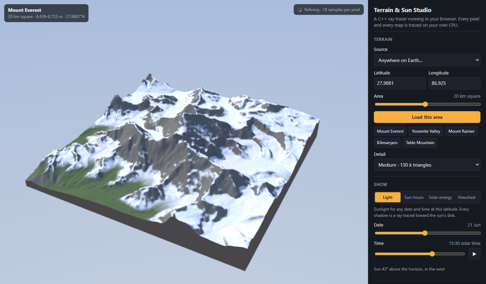
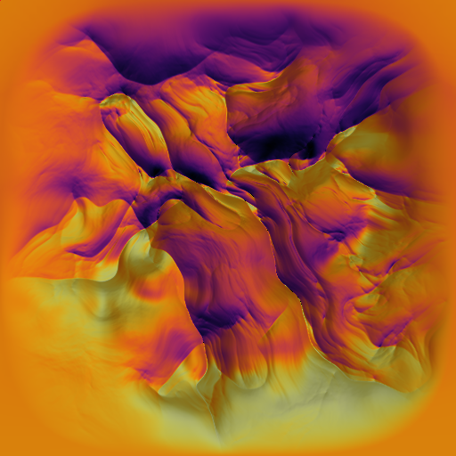
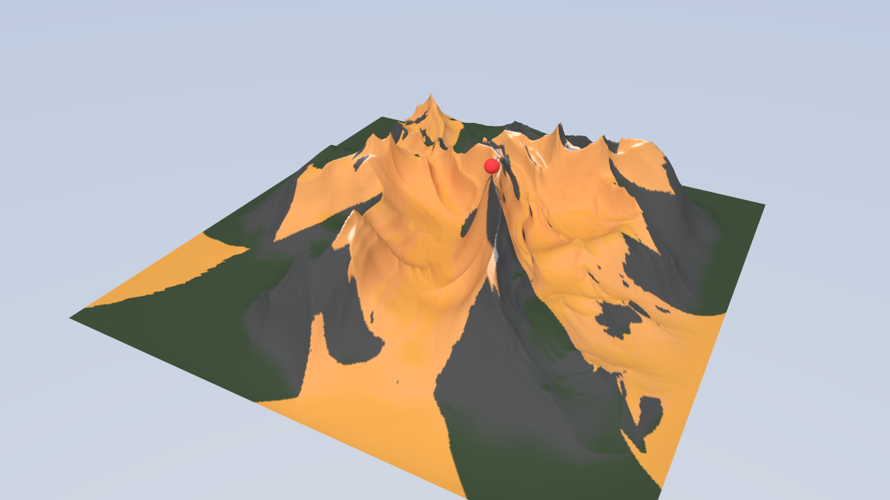
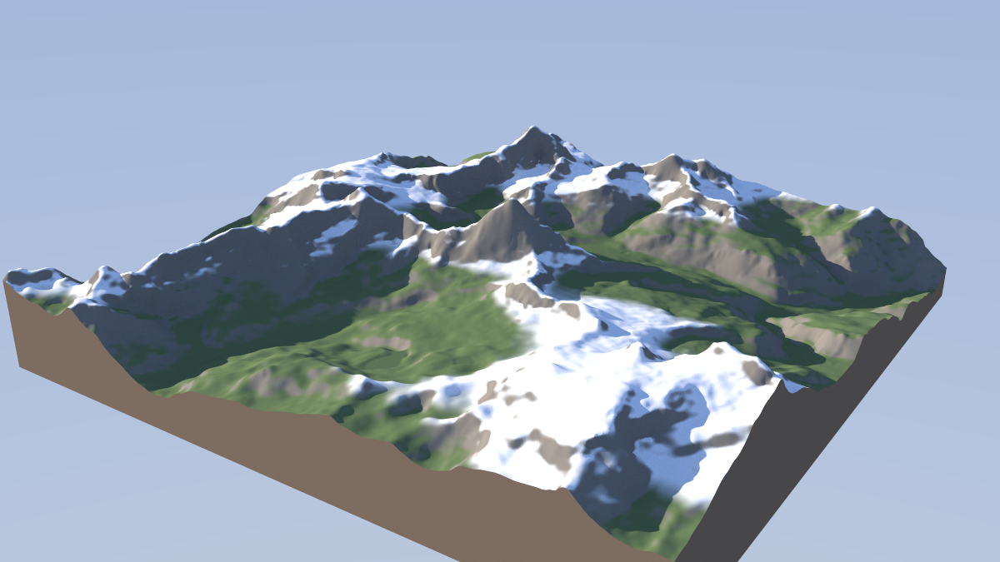
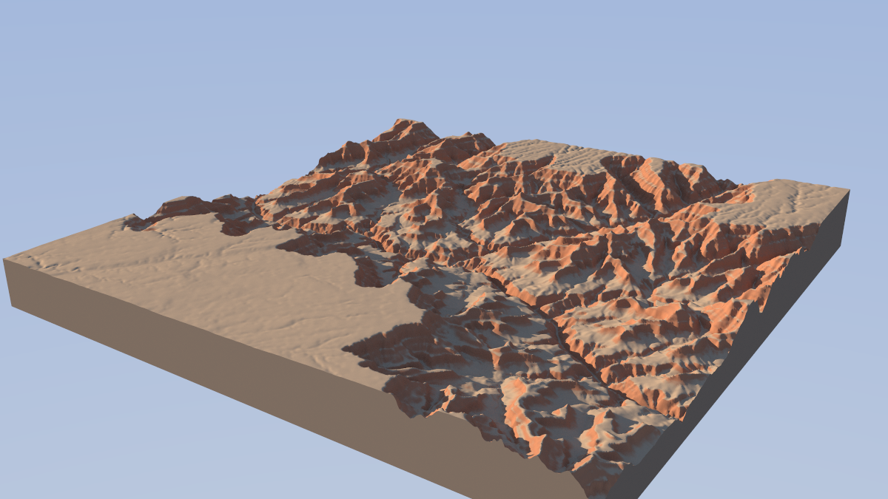
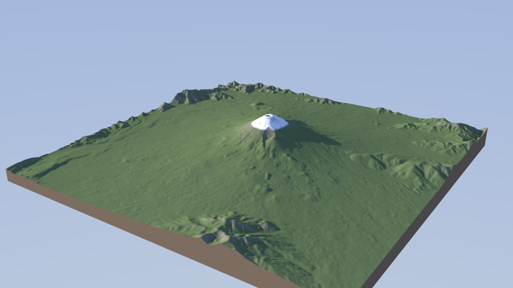
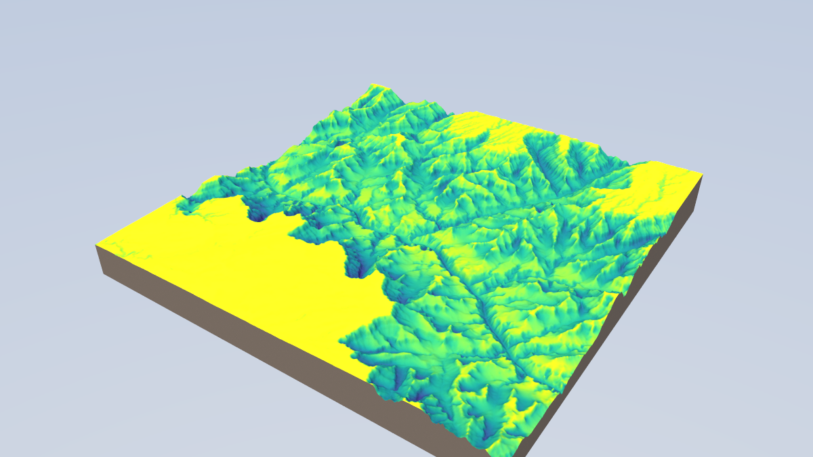
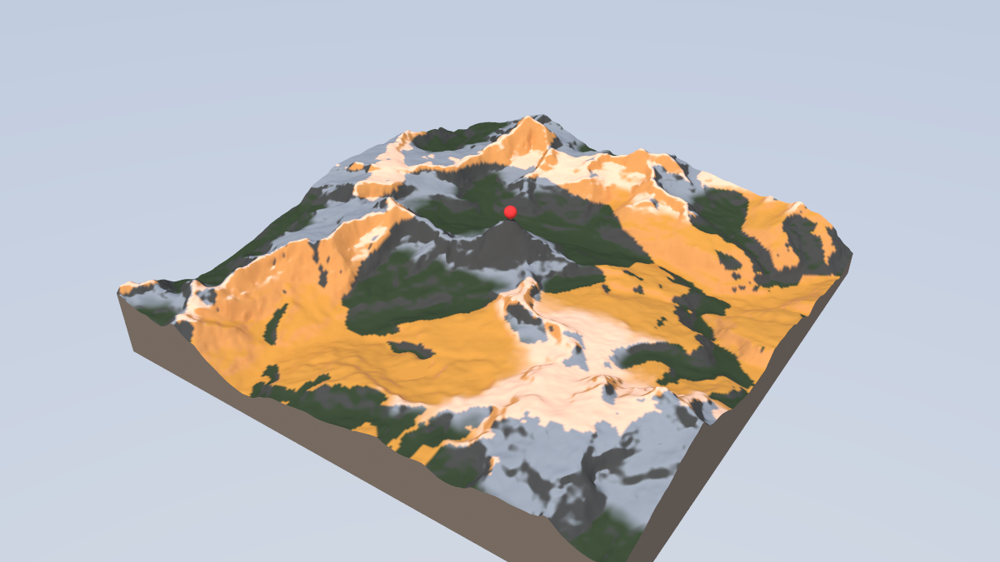

# Terrain & Sun Studio

[](https://github.com/Psybernetic7/ray-tracer/actions/workflows/ci.yml)
[](https://github.com/Psybernetic7/ray-tracer/actions/workflows/pages.yml)

A multithreaded ray tracer written in C++ that generates fractal terrain from a seed, or loads
real elevation data for any place on Earth, renders it under the real sun, and uses the same rays
to answer practical questions about it: how many hours of direct sun each slope gets in a year,
how much solar energy lands on it, and what can be seen from any point. It runs as a command-line
tool and, compiled to WebAssembly, as an interactive app in the browser. It also still renders
the scene of diffuse, metal and glass spheres it started as.

**[▶ Try it in your browser](https://psybernetic7.github.io/ray-tracer/)**: nothing to install;
every pixel is traced on your own CPU, on all of its cores.


*A 512×512 heightfield (about 522,000 triangles) generated from seed 1 and rendered at 1200×675.*

## Highlights

- **40× faster than where it started:** a bounding volume hierarchy and a tile renderer on every
  core take the original sphere scene from 25.1 s to 0.62 s
- **Half a million triangles, barely slower than thirty thousand:** sixteen times the geometry
  costs only 1.4× the render time
- **Horizon maps make a year of sun cheap:** measuring each point's skyline once turns every sun
  position into a table lookup, 40× faster than brute force at fine sampling and within 1% of it
- **Real places, no GIS library:** public elevation tiles are decoded, stitched and resampled by
  the engine itself, for any square of the Earth
- **One engine, two front ends:** the C++ core has no file or network code in it, so the same
  headers build a native CLI and a 180 KB WebAssembly module that runs at about half native speed
- **Tested and deployed by CI:** 51 unit tests and two end-to-end runs on Ubuntu and Windows for
  every push, and every push to `main` republishes the browser app

## Contents

- [How it works](#how-it-works)
- [Quick start](#quick-start)
- [Features](#features)
- [Browser app](#browser-app)
- [Command line](#command-line)
- [Performance](#performance)
- [Building and testing](#building-and-testing)
- [Project structure](#project-structure)
- [Roadmap](#roadmap)
- [Elevation data credits](#elevation-data-credits)

## How it works

1. **Generate a landscape, or load a real one.** Layers of smooth random noise are stacked, from
   broad mountain shapes down to small bumps, into a grid of heights; the same seed always gives
   the same mountains. Or the grid is filled from public elevation tiles of a real place.
2. **Turn it into triangles.** Each square of the grid becomes two triangles, about half a million
   for the default terrain, organised in a bounding volume hierarchy so a ray only has to test a
   handful of them.
3. **Render it.** For every pixel, rays are traced from the camera into the scene. Where one hits
   the ground, a second ray is aimed at the sun: if anything blocks it, that spot is in shadow.
   Grass, rock and snow are chosen from how steep and how high the ground is.
4. **Analyse it.** The same "is anything in the way?" ray answers practical questions. Aim it at
   the sun's position for every daylight moment of a year and count the hours it gets through:
   that is the sun-hours map. Aim it from a summit at every point on the ground: that is what you
   can see from there.
5. **Run it anywhere.** The engine does no file or network I/O of its own. The command line wraps
   it with files and downloads; the browser app wraps it with a Web Worker and a page.

## Quick start

```bash
cmake -S . -B build -G Ninja && cmake --build build
ctest --test-dir build                                               # 51 unit tests + 2 end-to-end runs

./build/rt-cli --res 256 --width 600 --spp 32 --out preview.png      # a terrain render, in seconds
./build/rt-cli analyze --width 600 --spp 32 --out sun.png            # sun-hours: sun.png, sun-map.png, sun.csv
./build/rt-cli analyze --mode viewshed --width 600 --spp 32          # what the highest peak can see
./build/rt-cli --place matterhorn --width 600 --spp 32 --out mh.png  # a real mountain, offline
./build/rt-cli --center 27.988,86.925 --extent 20 --out everest.png  # anywhere: tiles are downloaded
```

On Windows the program is `.\build\rt-cli.exe`. Rendered images and CSV files written to the
repository root are ignored by git. To run the browser app locally, see
[Browser app](#run-it-locally).

## Features

### Terrain

- **Fractal terrain from a seed:** seeded gradient noise summed into fBm for rolling ground and into a ridged multifractal for sharp crests, blended by a single `--ridge` dial
- **Domain warping:** the sample point is displaced by a second noise field, so ridges bend and branch instead of running straight
- **Heightfield meshing:** the height grid becomes two triangles per cell with shared vertex normals for smooth shading, and goes straight into the existing BVH
- **Triangle primitive:** Möller–Trumbore intersection, interpolated normals and surface coordinates
- **Directional sun with shadow rays:** the sun is sampled directly at every diffuse hit (next-event estimation) rather than found by chance, and its 0.265° disk gives soft-edged shadows
- **Any-hit shadow queries:** `occluded()` stops at the first blocker instead of searching for the nearest one, and the BVH skips whole subtrees once one is found
- **Shading by slope and height:** grass on gentle low ground, bare rock where the slope is too steep to hold soil, snow on high ground that is flat enough to keep it, with no textures involved

### Real places

- **Real elevation data:** AWS Open Data [Terrain Tiles](https://registry.opendata.aws/terrain-tiles/) in the Terrarium format, where height is encoded in a PNG's colour, so a plain image decoder reads them and no GIS library is needed, in the CLI or in the browser
- **Any square of the Earth:** latitude and longitude become Web Mercator tile coordinates; the tiles are downloaded once, stitched seamlessly and resampled onto a grid that is square in metres
- **Automatic detail level:** the tile zoom is picked so the data is at least as fine as the grid it fills, and no finer
- **Bundled places:** the Grand Canyon, the Matterhorn and Mount Fuji ship with the repository, so they render and analyse offline and in CI
- **Real sun:** the analysis uses the place's own latitude, and its CSV gains latitude, longitude and elevation in metres for every cell
- **Relief-model framing:** a cut-out of real terrain is rendered as a solid block with earth-coloured sides, with a real snow line and a desert palette where it fits

### Sun and visibility analysis

- **Solar position:** NOAA's equations give the sun's direction for any latitude, day and time, checked against known values such as London's 62° midsummer noon sun
- **Annual sun-hours:** for every cell of a grid over the terrain, add up the hours its ground can see the sun across a sampled year
- **Solar irradiance:** the same, weighted by how squarely the sun strikes the slope and by clear-sky atmospheric attenuation, in kWh/m² per year: the number solar-panel siting uses
- **Horizon maps:** measure each cell's skyline once in 64 compass directions, and every sun position after that is a table lookup instead of a ray. The answer is checked against brute force, which casts a ray per cell per sun position
- **Viewsheds:** everything visible from an observer, one ray per cell
- **Three outputs per analysis:** a 3D render with the result painted onto the terrain, a flat top-down map with relief shading, and the raw values as CSV for a spreadsheet, pandas or a GIS
- **Perceptually uniform colormaps:** viridis and inferno

### In the browser

- **The same engine, in the browser:** the C++ core compiled to WebAssembly with Emscripten; nothing is rendered on a server
- **Multithreaded:** WebAssembly threads on every core when the page is cross-origin isolated, with a single-threaded build as the fallback
- **Progressive and responsive:** the engine runs in a Web Worker; every change shows a quarter-size preview at once, then full-size passes refine it, and the next change interrupts within one pass
- **Orbit camera:** drag, scroll or pinch; arrow keys too
- **Real sun:** any date and time of day at the terrain's latitude, with twilight, and a button that plays the day
- **Live analysis:** sun-hours, solar energy and viewsheds painted onto the terrain, with a legend drawn from the engine's own colormaps; changing the latitude only redoes the table lookups, because the horizon map is kept
- **Click a point** to see everything visible from it, and hover anywhere to read the value, elevation and coordinates there
- **Anywhere on Earth:** elevation tiles are fetched straight from AWS by the browser and decoded by the engine; downloaded areas get a rough snow line for their latitude
- **Deployed by CI:** GitHub Actions builds both WebAssembly modules and the site, and publishes it to GitHub Pages

### Renderer

- **Three materials:** Lambertian (diffuse), metal with adjustable fuzz, and dielectric (glass) with refraction and Schlick's reflectance approximation
- **Positionable camera:** configurable vertical field of view, look-from / look-at points and up vector
- **Depth of field:** defocus blur controlled by defocus angle and focus distance
- **Antialiasing:** multiple random samples per pixel
- **Gamma correction:** linear-to-gamma 2 transform on output
- **Multithreaded tile renderer:** the image is split into 32×32 tiles that worker threads pull from a shared counter
- **Bounding volume hierarchy (BVH):** rays skip whole groups of objects whose bounding box they miss
- **Reproducible renders:** the random generator is reseeded per tile, so the same seed gives the same image on any number of threads
- **Progressive rendering:** samples accumulate across passes, so an image can be refined over time
- **PNG and PPM output**

## Browser app

**[Open the app](https://psybernetic7.github.io/ray-tracer/)**



*Mount Everest, 20 km square, downloaded and ray-traced in the browser on 16 threads.*

### Using it

- **Terrain:** generate a fractal range (change the seed, ridges, warp and height), open one of
  the bundled places, or pick "Anywhere on Earth" and enter a latitude and longitude, or choose an
  example such as Mount Everest or Yosemite Valley
- **Show:** *Light* for the rendered terrain under the sun at a chosen date and time; *Sun-hours*
  and *Solar energy* for the yearly maps; *Viewshed* to see what is visible from a red marker,
  which you move by clicking the terrain
- **Camera:** drag to orbit, scroll or pinch to zoom, or use the arrow keys
- **Read-out:** hover over the terrain for the value, elevation and coordinates under the cursor
- **Under the hood:** the panel at the bottom shows the thread count, triangle count and how long
  each step took

### How it is built

The app lives in [apps/web/](apps/web/) and has four layers:

1. **[studio.h](apps/web/native/studio.h):** a C++ session class that keeps the terrain, camera,
   sun and analysis between calls, and redoes only what a change affects. Moving the camera
   keeps the mesh; changing the latitude keeps the horizon map. It is plain C++, so the unit
   tests drive it without a browser.
2. **[bindings.cc](apps/web/native/bindings.cc):** a thin
   [embind](https://emscripten.org/docs/porting/connecting_cpp_and_javascript/embind.html) layer
   that exposes the session to JavaScript. Elevation PNGs are decoded here with stb_image rather
   than by the browser, whose colour management could change the heights the colours encode.
3. **[worker.ts](apps/web/src/worker.ts):** a Web Worker that loads the WebAssembly module, runs
   the progressive render loop and downloads elevation tiles, so the page never freezes.
4. **[main.ts](apps/web/src/main.ts):** the page: controls, camera interaction and drawing. It
   talks to the worker only through the messages in [protocol.ts](apps/web/src/protocol.ts).

Threads in WebAssembly share memory through `SharedArrayBuffer`, which browsers only allow on a
page served with two cross-origin isolation headers. The dev server sends them; GitHub Pages
can't, so [coi-serviceworker.js](apps/web/public/coi-serviceworker.js) adds them from a service
worker and reloads the page once. Where that isn't possible, the app loads the single-threaded
module instead.

### Run it locally

You need the [Emscripten SDK](https://emscripten.org/docs/getting_started/downloads.html)
(4.0.10, the version CI uses) activated in your shell, plus Node.js and Ninja:

```bash
cd apps/web
npm install
npm run wasm      # builds public/wasm/studio-mt and studio-st with Emscripten
npm run dev       # http://localhost:5173
```

`npm run build` writes the finished site to `apps/web/dist/`, and `npm run preview` serves it.
Add `?single` to the address to force the single-threaded build.

To publish your own copy, enable GitHub Pages with "GitHub Actions" as the source in the
repository settings; [pages.yml](.github/workflows/pages.yml) then deploys every push to `main`.

## Command line

### Rendering

```bash
./build/rt-cli --out terrain.png
```

| Option | Default | Description |
| --- | --- | --- |
| `--scene NAME` | `terrain` | `terrain` for the fractal mountains, `showcase` for the sphere scene |
| `--width N` | `1200` | Image width in pixels (height follows the 16:9 aspect ratio) |
| `--spp N` | `500` | Samples per pixel |
| `--threads N` | `0` | Worker threads; `0` uses every hardware thread |
| `--seed N` | `1` | Random seed for the scene layout and the render |
| `--no-bvh` | off | Intersect objects with a linear scan instead of the BVH |
| `--quiet` | off | Don't print progress |
| `--out PATH` | `image.png` | Output file, `.png` or `.ppm` |

For a quick preview, use something like `--res 256 --width 500 --spp 32`.

### Terrain options

| Option | Default | Description |
| --- | --- | --- |
| `--res N` | `512` | Heightfield vertices per side; the triangle count grows with the square of this |
| `--octaves N` | `9` | Noise octaves; more octaves means finer detail at a linear cost |
| `--frequency F` | `1.6` | Mountains across the field at the coarsest octave |
| `--ridge F` | `0.78` | `0` is rounded fBm hills, `1` is pure ridged multifractal |
| `--warp F` | `0.35` | Domain warp strength; `0` turns warping off |
| `--height F` | `3.2` | World height of the tallest possible peak |
| `--sun-elev D` | `19` | Sun elevation above the horizon, in degrees |
| `--sun-azim D` | `250` | Sun azimuth, in compass degrees: `0` north, `90` east |
| `--no-sun` | off | Light with the sky alone: no sun and no shadow rays |
| `--no-plain` | off | Leave out the flat plain the terrain sits on |

`--seed` picks the mountain range: the same seed always generates the same terrain.

```bash
# A different range, with rounder hills and a sun low in the east
./build/rt-cli --seed 7 --ridge 0.3 --sun-elev 12 --sun-azim 95 --out hills.png
```

### Analysis

```bash
./build/rt-cli analyze --mode sun-hours --lat 46.5 --out sun.png
```

This writes three files: `sun.png`, the 3D render with sun-hours painted on; `sun-map.png`, a
top-down map with north up; and `sun.csv`, one row per cell with its position, elevation and value.
It also prints the range and mean of the result.

```bash
# Direct-beam solar energy instead of hours
./build/rt-cli analyze --quantity irradiance --out energy.png

# Run brute force and the horizon map side by side, and report their agreement and speed
./build/rt-cli analyze --method compare --no-render

# Everything visible from the highest peak, and from a chosen point with a 10 m mast
./build/rt-cli analyze --mode viewshed --out view.png
./build/rt-cli analyze --mode viewshed --observer 0.3,0.7 --target 0.01 --out mast.png
```

| Option | Default | Description |
| --- | --- | --- |
| `--mode NAME` | `sun-hours` | `sun-hours` or `viewshed` |
| `--out PATH` | `<mode>.png` | The render; the map and CSV are named after it |
| `--grid N` | `256` | Analysis cells per side |
| `--no-render` | off | Write only the map and the CSV |
| `--width N`, `--spp N` | `1200`, `64` | Render size and samples per pixel |
| `--lat D` | place, or `46.5` | Latitude in degrees north: a real place's own, or 46.5 (through the Swiss Alps) for generated terrain |
| `--day-step N` | `7` | Sample every Nth day of the year |
| `--minutes N` | `15` | Time step through each sampled day |
| `--quantity NAME` | `hours` | `hours` per year, or `irradiance` in kWh/m² per year |
| `--method NAME` | `horizon` | `horizon`, `brute`, or `compare` to run both |
| `--observer U,V` | highest point | Viewshed observer, in 0–1 terrain coordinates (U west to east, V north to south) |
| `--eye F` | `0.002` | Observer height above the ground |
| `--target F` | `0` | Height above the ground that must be visible |

The terrain options (`--seed`, `--res`, `--ridge` and the rest) work here too. World units can be
read as kilometres: the default terrain is 10 km across with peaks up to 3.2 km, so `--eye 0.002`
is a person standing on the summit.

Sun-hours count direct sun only and assume a clear sky every day: they measure how much the
terrain shades each point, not the local weather. Irradiance uses Meinel's clear-sky model and
leaves out diffuse sky light, so treat it as an upper bound that is consistent from one slope to
the next.


| Sun-hours | Irradiance | Viewshed |
| --- | --- | --- |
|  |  |  |
| Hours of direct sun per year. The median cell gets about 3,000; the deepest north-facing hollows get under 1,000, and a few south faces get all 4,380 hours of daylight there are. | Direct-beam energy in kWh/m² per year, which also rewards slopes that face the sun squarely: the south faces light up. | Ground visible from the highest peak (red) in orange: 30% of the terrain. |

Maps are drawn with north at the top and lit from the north-west, the cartographic convention.



### Real places

```bash
./build/rt-cli --place matterhorn --out matterhorn.png                # bundled, works offline
./build/rt-cli --center 36.2465,-112.1134 --extent 12 --out rim.png   # any latitude,longitude
./build/rt-cli analyze --place grand-canyon --out canyon-sun.png      # sun-hours at 36.1° N
./build/rt-cli analyze --place matterhorn --mode viewshed --eye 0.01 --out summit.png
```



*The Matterhorn, 16 km square, from 30 m elevation data. The snow line is set at 2,900 m.*

| Grand Canyon | Mount Fuji |
| --- | --- |
|  |  |
| 24 km square across the canyon: the South Rim, the Colorado River 1,400 m below it, and the higher North Rim. | 32 km square: the whole cone, its summit crater and the foothills. True scale, with no vertical exaggeration. |

| Sun-hours in the Grand Canyon | Viewshed from the Matterhorn |
| --- | --- |
|  |  |
| The plateaus get all 4,385 hours of daylight a year; north-facing walls and narrow side canyons get as few as 436. | Orange is the ground visible from the summit (red): 42% of the square. The summit's own steep faces stay hidden, as they do from any convex peak. |

| Option | Default | Description |
| --- | --- | --- |
| `--place NAME` | | `grand-canyon`, `matterhorn` or `fuji`, loaded from [data/places/](data/places/) |
| `--center LAT,LON` | | The centre of any square on Earth, in degrees north and east |
| `--extent KM` | `20` | Side of the square around `--center` |
| `--zoom N` | automatic | Tile zoom from 0 to 15; each step halves the pixel size and quadruples the download |
| `--exaggerate F` | `1` | Vertical exaggeration |
| `--download` | off | Fetch tiles for a `--place` instead of using its bundled copy (needed for `--res` above 512) |
| `--tile-cache DIR` | `tile-cache` | Where downloaded tiles are kept; each is downloaded once, ever |
| `--save-dem PATH` | | Also write the region's elevations as one Terrarium PNG. The bundled places were made this way |

These work with both `rt-cli` and `rt-cli analyze`. Real terrain is built at one world unit per
kilometre, so the analysis options keep their meaning: `--eye 0.002` is still a person 2 m tall,
and the sun is computed for the place's own latitude unless `--lat` overrides it. Downloading
needs `curl`, which comes with Windows 10 and later, macOS and Linux.

How much is downloaded for the default 512×512 grid:

| Place | Square | Zoom | Pixel size | Tiles | Download |
| --- | --- | --- | --- | --- | --- |
| Matterhorn | 16 km | 12 | 26.6 m | 12 | 1.6 MB |
| Grand Canyon | 24 km | 12 | 30.9 m | 16 | 2.2 MB |
| Mount Fuji | 32 km | 11 | 62.3 m | 9 | 0.5 MB |

**What 30 m data can't show.** A sharp summit is narrower than a data pixel, so the data rounds
it into a dome: the Matterhorn's 4,478 m peak comes out at 4,354 m at every zoom level up to 14.
That dome changes the viewshed. From 2 m above it you can't see down the faces, so only 13% of
the square is visible. Raising the eye to 10 m stands in for the missing pinnacle and brings it to
42%. Sun-hours are much less sensitive, because a lost spire only shades a few cells.

**Agreement on real terrain.** Horizon maps and brute force agree even more closely on real
terrain than on the fractal range. On the Matterhorn, with the default year sampling, the mean
difference is 0.08% of the maximum and the worst cell 0.7%. The horizon map is 2.6× faster and
casts 6.1× fewer rays.

### Camera settings

Each scene sets up its own camera in [engine/scenes.h](engine/scenes.h). The sphere scene's
`showcase_scene` uses:

| Setting | Value | Description |
| --- | --- | --- |
| `aspect_ratio` | `16.0 / 9.0` | Image width over height |
| `max_depth` | `50` | Maximum ray bounces |
| `vfov` | `20` | Vertical field of view in degrees |
| `lookfrom` / `lookat` / `vup` | `(13,2,3)` / `(0,0,0)` / `(0,1,0)` | Camera position, target and up direction |
| `defocus_angle` | `0.6` | Variation angle of rays through each pixel |
| `focus_dist` | `10.0` | Distance to the plane of perfect focus |

## Performance

All timings are on an Intel i7-10870H (8 cores, 16 threads).

### Terrain

Terrain scene at 400×225 and 32 samples per pixel. The heightfield's resolution sets the triangle
count: a 512×512 grid is 522,242 triangles. "Build" covers generating the terrain, meshing it and
building the BVH; each figure is the middle of three runs.

| Grid | Triangles | Build | Render |
| --- | --- | --- | --- |
| 128×128 | 32,258 | 0.05 s | 0.80 s |
| 256×256 | 130,050 | 0.20 s | 0.97 s |
| 512×512 | 522,242 | 0.92 s | 1.09 s |

Sixteen times the geometry costs about 1.4× the render time, which is the BVH doing its job: the
cost of a ray grows with the *depth* of the tree, not the number of triangles in it. The build is
what actually scales with the triangle count, and at 512×512 three quarters of it is the BVH
itself; generating the terrain runs on every thread and takes 0.02 s.

To show the same thing from the other side, here is a deliberately small mesh (7,938 triangles at
200×112 and 8 samples per pixel) with and without the BVH:

| Configuration | Time | Speedup |
| --- | --- | --- |
| BVH | 0.06 s | 106× |
| Linear scan over every triangle | 6.37 s | 1× |

Direct sun lighting costs about 22% on top of a sky-lit render of the same terrain (1.12 s against
0.91 s at 512×512), and buys crisp shadows with soft penumbrae that path tracing alone would never
find: the sun covers about 0.001% of the sky's hemisphere, so a scattered ray essentially never
lands on it. The shadow ray that replaces that search uses `occluded()`, which returns at the first
blocker it meets rather than looking for the nearest one.

The full 1200×675 hero image at 400 samples per pixel takes 134 s.

### Sun-hours: brute force against horizon maps

Annual sun-hours for a 256×256 grid over the 512×512 terrain at latitude 46.5°, computed both ways
with `rt-cli analyze --method compare`, for increasingly fine samplings of the year:

| Year sampled | Sun positions | Brute force | Horizon map | Speedup | Worst cell difference |
| --- | --- | --- | --- | --- | --- |
| Every 30 days, 30-minute steps | 304 | 1.9 s | 5.6 s | 0.3× | 2.0% |
| Every 7 days, 15-minute steps (default) | 2,545 | 15.5 s | 5.9 s | 2.6× | 1.3% |
| Every day, 15-minute steps | 17,610 | 112 s | 7.0 s | 16× | 1.0% |
| Every day, 5-minute steps | 52,826 | 333 s | 8.4 s | 40× | 0.9% |

Brute force casts one shadow ray per cell per sun position, so its cost is proportional to how
finely the year is sampled: 3.5 billion rays for the last row. The horizon map instead measures
each cell's skyline in 64 compass directions (24 million rays, the same in every row), after which
a sun position costs a table lookup: is the sun higher than the skyline beneath it? Only those
lookups grow with the sampling, by about 2 seconds at the finest. The crossover sits around a
thousand sun positions; below it, brute force is simply cheaper.

Two details make the skyline search cheap. Because terrain is a heightfield, a blocked ray means
every lower ray in that direction is blocked too, so the skyline can be found by bisection on
elevation. And neighbouring directions have nearly the same skyline, so each search starts from
the previous direction's answer and only has to pin down a degree or two. Most directions from a
ridge have no skyline at all and cost one ray.

The two methods agree to within 0.1% of the maximum on average in every row; the worst cells are
the ones where a sharp peak's silhouette falls between two of the 64 sampled directions.

### Native against WebAssembly

The same horizon map built natively and in Chrome: fractal terrain at 256×256 (130,050
triangles), 160×160 analysis cells, 64 directions. Both cast exactly the same 9,310,408 rays,
which also shows the two builds compute the same thing. Browser figures are the middle of three
runs.

| Build | 16 threads | 1 thread |
| --- | --- | --- |
| Native (g++ -O3) | 2.46 s | 15.89 s |
| WebAssembly (Emscripten -O3, SIMD) | 4.63 s | 30.50 s |

WebAssembly runs at about half native speed, and threads help both equally: 6.5× on 8 cores with
hyper-threading. The two modules are about 180 KB each.

### Spheres


Showcase scene (about 480 spheres) at 400×225 and 32 samples per pixel:

| Configuration | Time | Speedup |
| --- | --- | --- |
| Original single-file version, `g++ -O2` | 25.1 s | 1× |
| Original single-file version, `g++ -O3` | 15.7 s | 1.6× |
| Linear object scan, 1 thread | 15.7 s | 1.6× |
| BVH, 1 thread | 3.54 s | 7.1× |
| BVH, 2 threads | 2.10 s | 12× |
| BVH, 4 threads | 1.16 s | 22× |
| BVH, 8 threads | 0.77 s | 33× |
| BVH, 16 threads | 0.62 s | 40× |

The full 1200×675 image at 500 samples per pixel renders in about 80 seconds.

Thread scaling flattens past 8 threads because the CPU has 8 physical cores; the extra 8 are
hyper-threads sharing them.

Two changes prepare the code for threads without making a single thread faster. Each thread has
its own random generator, because `std::rand` is not guaranteed to be thread-safe and can't be
seeded per tile. Hit records hold a plain material pointer instead of a `shared_ptr`, because
copying a `shared_ptr` updates an atomic reference count that every thread would hit on every ray
intersection.

## Building and testing

### Tech stack

- **Engine and command line:** C++17, built with CMake
- **Browser app:** the same C++ compiled to WebAssembly with Emscripten, and a TypeScript front end built with Vite
- **Dependencies:** the C++ standard library, plus three vendored single-header libraries in [third_party/](third_party/): [stb_image](https://github.com/nothings/stb) and stb_image_write for PNG input and output, and [doctest](https://github.com/doctest/doctest) for unit tests. The front end's only packages are Vite and TypeScript

### Prerequisites

- A C++17 compiler such as `g++`, `clang++` or MSVC
- CMake 3.20 or newer (Ninja recommended)
- For the browser app only: the Emscripten SDK 4.0.10 and Node.js

On Windows, MSYS2 provides the compiler, CMake and Ninja: install `mingw-w64-x86_64-gcc`,
`mingw-w64-x86_64-cmake` and `mingw-w64-x86_64-ninja` with `pacman`, then put
`C:\msys64\mingw64\bin` on your `PATH` before building.

### Build

```bash
git clone https://github.com/Psybernetic7/ray-tracer.git
cd ray-tracer
cmake -S . -B build -G Ninja
cmake --build build
```

### Run the tests

```bash
ctest --test-dir build --output-on-failure
```

The 51 test cases check, among other things, that:

- the BVH finds exactly the hits a brute-force scan finds
- renders are identical on any number of threads
- rays can't slip between two triangles that share an edge
- the sun's position matches known values: London's 62° midsummer noon sun, Sydney's winter sun
  in the northern sky, and polar night
- horizon-map sun-hours agree with brute force on fractal terrain
- a viewshed is blocked by a ridge but sees a tall enough mast behind it
- Terrarium decoding matches Everest's height to the encoding's 1/256 m
- tile coordinates match the standard slippy-map tiles
- stitched tiles have no seams, checked with a ramp that bilinear filtering must reproduce exactly
- the browser app's session object renders progressively, picks the terrain under the cursor,
  matches the engine's sun-hours and reuses its horizon map when only the latitude changes

Two more tests render and analyse a bundled place end to end, offline. CI runs everything on
Ubuntu and Windows for every push, and builds the browser app as well.

## Project structure

```
.
├── engine/                 # Header-only core (no file, console or network I/O)
│   ├── rtheader.h          # Common includes and usings
│   ├── parallel.h          # parallel_for over a pool of threads
│   ├── math/               # vec3, ray, interval, color, colormaps, constants, random generator
│   ├── geometry/           # Hittable interface, sphere, triangle, heightfield, AABB, BVH
│   ├── terrain/            # Noise, fBm, ridged multifractal, shading, DEM tiles, place presets
│   ├── lighting/           # Directional sun, sky, solar position, clear-sky irradiance
│   ├── analysis/           # Analysis grid, sun-hours, horizon maps, viewsheds, overlay colours
│   ├── render/             # Camera, materials, framebuffer, multithreaded renderer
│   └── scenes.h            # Scene setup shared by the command line and the browser app
├── apps/cli/               # Command line: render and analyze commands, tile download, image and CSV I/O
├── apps/web/               # Browser app
│   ├── native/             # Session class and JavaScript bindings, compiled to WebAssembly
│   ├── src/                # Page, engine worker and their message protocol (TypeScript)
│   └── public/             # Service worker for cross-origin isolation
├── data/places/            # Bundled elevation for the preset places (Terrarium PNGs)
├── docs/                   # Reference renders, analysis maps and screenshots
├── tests/                  # Unit tests (doctest)
├── third_party/            # Vendored single-header libraries
├── .github/workflows/      # CI (native build and tests) and the web app build and deploy
└── CMakeLists.txt          # Native build, or the WebAssembly module under Emscripten
```

## Roadmap

The project is being built in milestones, each ending in something visible.

| Milestone | Status | What it adds |
| --- | --- | --- |
| M0 Foundation | Done | Engine library, BVH, multithreaded tile renderer, PNG output, CMake, tests, CI |
| M1 Fractal terrain | Done | Noise terrain, triangle meshes, directional sun and shadows, slope and height shading |
| M2 Sun and visibility analysis | Done | Solar position, sun-hours, irradiance, horizon maps, viewsheds, maps and CSV |
| M3 Real places | Done | Real elevation data from public terrain tiles for any place, with bundled Grand Canyon, Matterhorn and Mount Fuji |
| M4 Browser app | Done | WebAssembly build in a Web Worker: orbit, drag the sun, generate worlds, load any place, click a point to see its viewshed |
| M5 Showcase polish | Planned | Architecture diagram, design decision records, a hero animation, more benchmarks |

## Elevation data credits

Real terrain comes from the [Terrain Tiles](https://registry.opendata.aws/terrain-tiles/) dataset
on AWS Open Data (Mapzen, a Linux Foundation project). The bundled files in
[data/places/](data/places/) are resampled from it. Its
[attribution terms](https://github.com/tilezen/joerd/blob/master/docs/attribution.md) ask for the
following credits:

* ArcticDEM terrain data DEM(s) were created from DigitalGlobe, Inc., imagery and funded under National Science Foundation awards 1043681, 1559691, and 1542736;
* Australia terrain data © Commonwealth of Australia (Geoscience Australia) 2017;
* Austria terrain data © offene Daten Österreichs – Digitales Geländemodell (DGM) Österreich;
* Canada terrain data contains information licensed under the Open Government Licence – Canada;
* Europe terrain data produced using Copernicus data and information funded by the European Union - EU-DEM layers;
* Global ETOPO1 terrain data U.S. National Oceanic and Atmospheric Administration
* Mexico terrain data source: INEGI, Continental relief, 2016;
* New Zealand terrain data Copyright 2011 Crown copyright (c) Land Information New Zealand and the New Zealand Government (All rights reserved);
* Norway terrain data © Kartverket;
* United Kingdom terrain data © Environment Agency copyright and/or database right 2015. All rights reserved;
* United States 3DEP (formerly NED) and global GMTED2010 and SRTM terrain data courtesy of the U.S. Geological Survey.
