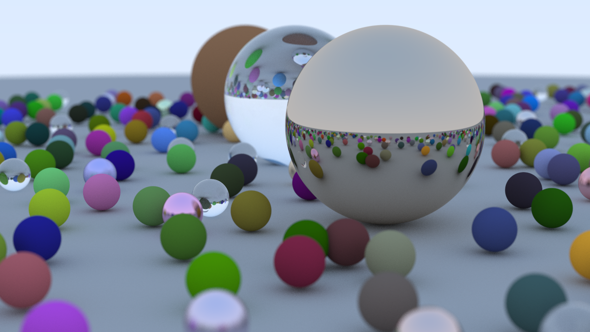

# Ray Tracer

A multithreaded ray tracer written in C++ that generates fractal terrain from a seed and renders it
under a directional sun, with cast shadows and slope-aware shading. It also still renders the scene
of diffuse, metal and glass spheres it started as.


*A 512×512 heightfield — about 522,000 triangles — generated from seed 1 and rendered at 1200×675.*

## Features

### Terrain

- **Fractal terrain from a seed:** seeded gradient noise summed into fBm for rolling ground and into a ridged multifractal for sharp crests, blended by a single `--ridge` dial
- **Domain warping:** the sample point is displaced by a second noise field, so ridges bend and branch instead of running straight
- **Heightfield meshing:** the height grid becomes two triangles per cell with shared vertex normals for smooth shading, and goes straight into the existing BVH
- **Triangle primitive:** Möller–Trumbore intersection, interpolated normals and surface coordinates
- **Directional sun with shadow rays:** the sun is sampled directly at every diffuse hit (next-event estimation) rather than found by chance, and its 0.265° disk gives soft-edged shadows
- **Any-hit shadow queries:** `occluded()` stops at the first blocker instead of searching for the nearest one, and the BVH skips whole subtrees once one is found
- **Shading by slope and height:** grass on gentle low ground, bare rock where the slope is too steep to hold soil, snow on high ground that is flat enough to keep it — no textures involved

### Renderer

- **Three materials:** Lambertian (diffuse), metal with adjustable fuzz, and dielectric (glass) with refraction and Schlick's reflectance approximation
- **Positionable camera:** configurable vertical field of view, look-from / look-at points and up vector
- **Depth of field:** defocus blur controlled by defocus angle and focus distance
- **Antialiasing:** multiple random samples per pixel
- **Gamma correction:** linear-to-gamma 2 transform on output
- **Multithreaded tile renderer:** the image is split into 32×32 tiles that worker threads pull from a shared counter
- **Bounding volume hierarchy (BVH):** rays skip whole groups of objects whose bounding box they miss
- **Reproducible renders:** the random generator is reseeded per tile, so the same seed gives the same image on any number of threads
- **Progressive rendering:** samples accumulate across passes, so an image can be refined over time
- **PNG and PPM output**

## Tech Stack

- **Language:** C++17
- **Build:** CMake
- **Dependencies:** C++ standard library, plus two vendored single-header libraries in [third_party/](third_party/): [stb_image_write](https://github.com/nothings/stb) for PNG output and [doctest](https://github.com/doctest/doctest) for unit tests

## Getting Started

### Prerequisites

- A C++17 compiler such as `g++`, `clang++` or MSVC
- CMake 3.20 or newer (Ninja recommended)

### Installation

```bash
git clone https://github.com/Psybernetic7/ray-tracer.git
cd ray-tracer
```

### Build

```bash
cmake -S . -B build -G Ninja
cmake --build build
```

### Run the tests

```bash
ctest --test-dir build --output-on-failure
```

## Usage

```bash
./build/rt-cli --out terrain.png
```

| Option | Default | Description |
| --- | --- | --- |
| `--scene NAME` | `terrain` | `terrain` for the fractal mountains, `showcase` for the sphere scene |
| `--width N` | `1200` | Image width in pixels (height follows the 16:9 aspect ratio) |
| `--spp N` | `500` | Samples per pixel |
| `--threads N` | `0` | Worker threads; `0` uses every hardware thread |
| `--seed N` | `1` | Random seed for the scene layout and the render |
| `--no-bvh` | off | Intersect objects with a linear scan instead of the BVH |
| `--quiet` | off | Don't print progress |
| `--out PATH` | `image.png` | Output file, `.png` or `.ppm` |

For a quick preview, use something like `--res 256 --width 500 --spp 32`.

### Terrain options

| Option | Default | Description |
| --- | --- | --- |
| `--res N` | `512` | Heightfield vertices per side; the triangle count grows with the square of this |
| `--octaves N` | `9` | Noise octaves; more octaves means finer detail at a linear cost |
| `--frequency F` | `1.6` | Mountains across the field at the coarsest octave |
| `--ridge F` | `0.78` | `0` is rounded fBm hills, `1` is pure ridged multifractal |
| `--warp F` | `0.35` | Domain warp strength; `0` turns warping off |
| `--height F` | `3.2` | World height of the tallest possible peak |
| `--sun-elev D` | `19` | Sun elevation above the horizon, in degrees |
| `--sun-azim D` | `250` | Sun azimuth, in compass degrees: `0` north, `90` east |
| `--no-sun` | off | Light with the sky alone — no sun and no shadow rays |
| `--no-plain` | off | Leave out the flat plain the terrain sits on |

`--seed` picks the mountain range: the same seed always generates the same terrain.

```bash
# A different range, with rounder hills and a sun low in the east
./build/rt-cli --seed 7 --ridge 0.3 --sun-elev 12 --sun-azim 95 --out hills.png
```

### Camera settings

Each scene sets up its own camera in [apps/cli/scenes.h](apps/cli/scenes.h). The sphere scene's
`showcase_scene` uses:

| Setting | Value | Description |
| --- | --- | --- |
| `aspect_ratio` | `16.0 / 9.0` | Image width over height |
| `max_depth` | `50` | Maximum ray bounces |
| `vfov` | `20` | Vertical field of view in degrees |
| `lookfrom` / `lookat` / `vup` | `(13,2,3)` / `(0,0,0)` / `(0,1,0)` | Camera position, target and up direction |
| `defocus_angle` | `0.6` | Variation angle of rays through each pixel |
| `focus_dist` | `10.0` | Distance to the plane of perfect focus |

## Performance

All timings are on an Intel i7-10870H (8 cores, 16 threads).

### Terrain

Terrain scene at 400×225 and 32 samples per pixel. The heightfield's resolution sets the triangle
count: a 512×512 grid is 522,244 triangles.

| Grid | Triangles | BVH build | Render |
| --- | --- | --- | --- |
| 128×128 | 32,260 | 0.11 s | 1.76 s |
| 256×256 | 130,052 | 0.51 s | 2.24 s |
| 512×512 | 522,244 | 2.36 s | 2.61 s |

Sixteen times the geometry costs about 1.5× the render time, which is the BVH doing its job: the
cost of a ray grows with the *depth* of the tree, not the number of triangles in it. The build is
what actually scales with the triangle count.

To show the same thing from the other side, here is a deliberately small mesh — 7,938 triangles at
200×112 and 8 samples per pixel — with and without the BVH:

| Configuration | Time | Speedup |
| --- | --- | --- |
| BVH | 0.10 s | 109× |
| Linear scan over every triangle | 10.86 s | 1× |

Direct sun lighting costs about 20% on top of a sky-lit render of the same terrain (2.41 s against
2.01 s at 512×512), and buys hard-edged, correctly soft-penumbra shadows that path tracing alone
would never find: the sun covers 0.0005% of the hemisphere, so a scattered ray essentially never
lands on it. The shadow ray that replaces that search uses `occluded()`, which returns at the first
blocker it meets rather than looking for the nearest one.

The full 1200×675 hero image at 400 samples per pixel takes 254 s.

### Spheres



Showcase scene (about 480 spheres) at 400×225 and 32 samples per pixel:

| Configuration | Time | Speedup |
| --- | --- | --- |
| Original single-file version, `g++ -O2` | 25.1 s | 1× |
| Original single-file version, `g++ -O3` | 15.7 s | 1.6× |
| Linear object scan, 1 thread | 15.7 s | 1.6× |
| BVH, 1 thread | 3.54 s | 7.1× |
| BVH, 2 threads | 2.10 s | 12× |
| BVH, 4 threads | 1.16 s | 22× |
| BVH, 8 threads | 0.77 s | 33× |
| BVH, 16 threads | 0.62 s | 40× |

The full 1200×675 image at 500 samples per pixel renders in about 80 seconds.

Thread scaling flattens past 8 threads because the CPU has 8 physical cores; the extra 8 are hyper-threads sharing them.

Two changes prepare the code for threads without making a single thread faster. Each thread has its own random generator, because `std::rand` is not guaranteed to be thread-safe and can't be seeded per tile. Hit records hold a plain material pointer instead of a `shared_ptr`, because copying a `shared_ptr` updates an atomic reference count that every thread would hit on every ray intersection.

## Project Structure

```
.
├── engine/                 # Header-only rendering core (no file or console I/O)
│   ├── rtheader.h          # Common includes and usings
│   ├── math/               # vec3, ray, interval, color, constants, random generator
│   ├── geometry/           # Hittable interface, sphere, triangle, heightfield, AABB, BVH
│   ├── terrain/            # Gradient noise, fBm, ridged multifractal, terrain shading
│   ├── lighting/           # Directional sun and sky
│   └── render/             # Camera, materials, framebuffer, multithreaded renderer
├── apps/cli/               # Command-line renderer: options, scene setup, image writing
├── docs/                   # Reference renders
├── tests/                  # Unit tests (doctest)
├── third_party/            # Vendored single-header libraries
└── CMakeLists.txt
```


