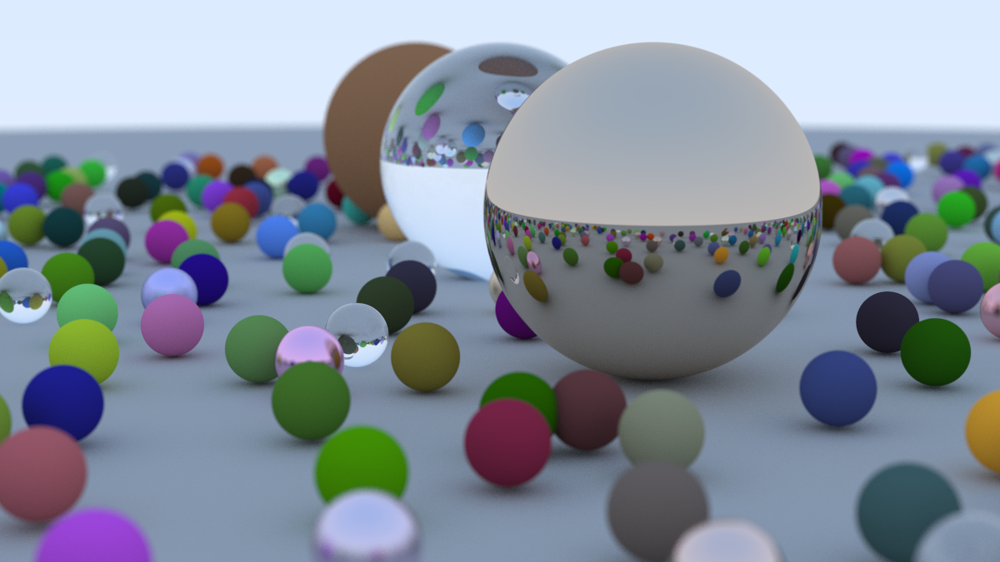

# Ray Tracer

A multithreaded ray tracer written in C++ that renders a scene of diffuse, metal and glass spheres to a PNG image.



## Features

- **Three materials:** Lambertian (diffuse), metal with adjustable fuzz, and dielectric (glass) with refraction and Schlick's reflectance approximation
- **Positionable camera:** configurable vertical field of view, look-from / look-at points and up vector
- **Depth of field:** defocus blur controlled by defocus angle and focus distance
- **Antialiasing:** multiple random samples per pixel
- **Gamma correction:** linear-to-gamma 2 transform on output
- **Multithreaded tile renderer:** the image is split into 32×32 tiles that worker threads pull from a shared counter
- **Bounding volume hierarchy (BVH):** rays skip whole groups of objects whose bounding box they miss
- **Reproducible renders:** the random generator is reseeded per tile, so the same seed gives the same image on any number of threads
- **Progressive rendering:** samples accumulate across passes, so an image can be refined over time
- **PNG and PPM output**

## Tech Stack

- **Language:** C++17
- **Build:** CMake
- **Dependencies:** C++ standard library, plus two vendored single-header libraries in [third_party/](third_party/): [stb_image_write](https://github.com/nothings/stb) for PNG output and [doctest](https://github.com/doctest/doctest) for unit tests

## Getting Started

### Prerequisites

- A C++17 compiler such as `g++`, `clang++` or MSVC
- CMake 3.20 or newer (Ninja recommended)

### Installation

```bash
git clone https://github.com/Psybernetic7/ray-tracer.git
cd ray-tracer
```

### Build

```bash
cmake -S . -B build -G Ninja
cmake --build build
```

### Run the tests

```bash
ctest --test-dir build --output-on-failure
```

## Usage

```bash
./build/rt-cli --out image.png
```

| Option | Default | Description |
| --- | --- | --- |
| `--width N` | `1200` | Image width in pixels (height follows the 16:9 aspect ratio) |
| `--spp N` | `500` | Samples per pixel |
| `--threads N` | `0` | Worker threads; `0` uses every hardware thread |
| `--seed N` | `1` | Random seed for the scene layout and the render |
| `--no-bvh` | off | Intersect objects with a linear scan instead of the BVH |
| `--quiet` | off | Don't print progress |
| `--out PATH` | `image.png` | Output file, `.png` or `.ppm` |

For a quick preview, use something like `--width 400 --spp 32`.

### Camera settings

The camera is configured in `showcase_scene` in [apps/cli/scenes.h](apps/cli/scenes.h):

| Setting | Value | Description |
| --- | --- | --- |
| `aspect_ratio` | `16.0 / 9.0` | Image width over height |
| `max_depth` | `50` | Maximum ray bounces |
| `vfov` | `20` | Vertical field of view in degrees |
| `lookfrom` / `lookat` / `vup` | `(13,2,3)` / `(0,0,0)` / `(0,1,0)` | Camera position, target and up direction |
| `defocus_angle` | `0.6` | Variation angle of rays through each pixel |
| `focus_dist` | `10.0` | Distance to the plane of perfect focus |

## Performance

Showcase scene (about 480 spheres) at 400×225 and 32 samples per pixel, on an Intel i7-10870H (8 cores, 16 threads):

| Configuration | Time | Speedup |
| --- | --- | --- |
| Original single-file version, `g++ -O2` | 25.1 s | 1× |
| Original single-file version, `g++ -O3` | 15.7 s | 1.6× |
| Linear object scan, 1 thread | 15.7 s | 1.6× |
| BVH, 1 thread | 3.54 s | 7.1× |
| BVH, 2 threads | 2.10 s | 12× |
| BVH, 4 threads | 1.16 s | 22× |
| BVH, 8 threads | 0.77 s | 33× |
| BVH, 16 threads | 0.62 s | 40× |

The full 1200×675 image at 500 samples per pixel renders in about 80 seconds.

Thread scaling flattens past 8 threads because the CPU has 8 physical cores; the extra 8 are hyper-threads sharing them.

Two changes prepare the code for threads without making a single thread faster. Each thread has its own random generator, because `std::rand` is not guaranteed to be thread-safe and can't be seeded per tile. Hit records hold a plain material pointer instead of a `shared_ptr`, because copying a `shared_ptr` updates an atomic reference count that every thread would hit on every ray intersection.

## Project Structure

```
.
├── engine/                 # Header-only rendering core (no file or console I/O)
│   ├── rtheader.h          # Common includes and usings
│   ├── math/               # vec3, ray, interval, color, constants, random generator
│   ├── geometry/           # Hittable interface, sphere, hittable list, AABB, BVH
│   └── render/             # Camera, materials, framebuffer, multithreaded renderer
├── apps/cli/               # Command-line renderer: options, scene setup, image writing
├── tests/                  # Unit tests (doctest)
├── third_party/            # Vendored single-header libraries
└── CMakeLists.txt
```


