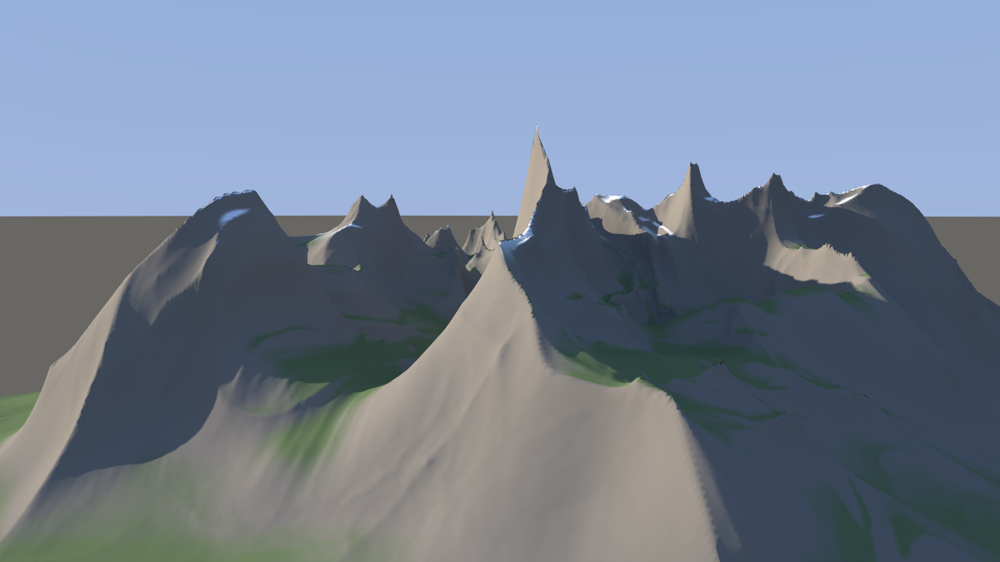
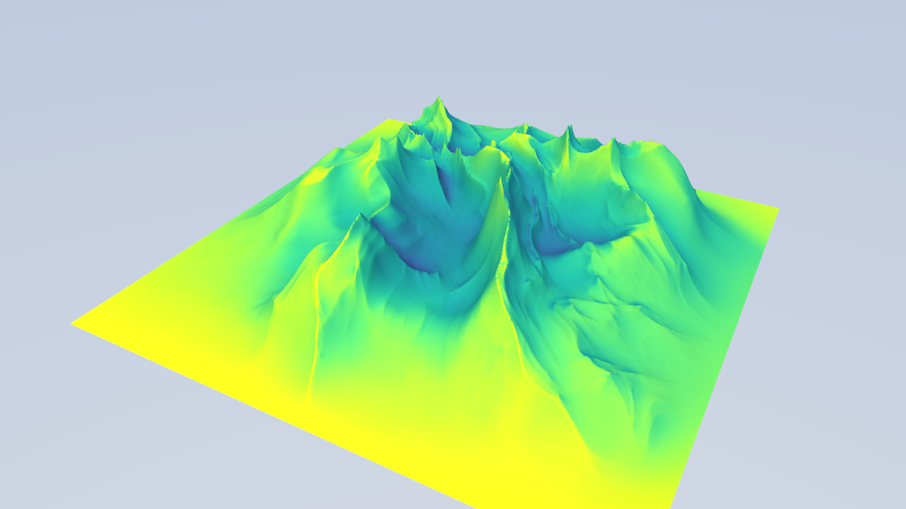
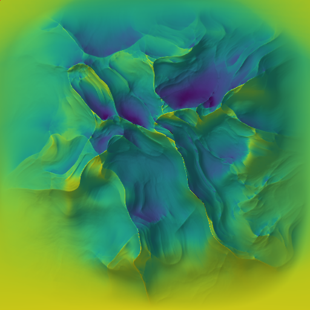
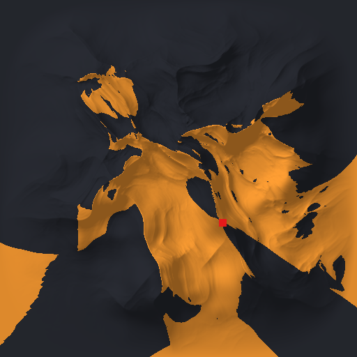

# Ray Tracer

[](https://github.com/Psybernetic7/ray-tracer/actions/workflows/ci.yml)

A multithreaded ray tracer written in C++ that generates fractal terrain from a seed, renders it
under a directional sun, and uses the same rays to answer practical questions about it: how many
hours of direct sun each slope gets in a year, how much solar energy lands on it, and what can be
seen from a given peak. It also still renders the scene of diffuse, metal and glass spheres it
started as.



*A 512×512 heightfield — about 522,000 triangles — generated from seed 1 and rendered at 1200×675.*

## How it works

1. **Generate a landscape.** Layers of smooth random noise are stacked, from broad mountain shapes
   down to small bumps, into a grid of heights. The same seed always gives the same mountains.
2. **Turn it into triangles.** Each square of the grid becomes two triangles, about half a million
   for the default terrain, organised in a bounding volume hierarchy so a ray only has to test a
   handful of them.
3. **Render it.** For every pixel, rays are traced from the camera into the scene. Where one hits
   the ground, a second ray is aimed at the sun: if anything blocks it, that spot is in shadow.
   Grass, rock and snow are chosen from how steep and how high the ground is.
4. **Analyse it.** The same "is anything in the way?" ray answers practical questions. Aim it at
   the sun's position for every daylight moment of a year and count the hours it gets through:
   that is the sun-hours map. Aim it from a summit at every point on the ground: that is what you
   can see from there.

## Quick start

```bash
cmake -S . -B build -G Ninja && cmake --build build
ctest --test-dir build                                   # 38 unit tests

./build/rt-cli --res 256 --width 600 --spp 32 --out preview.png    # a terrain render, in seconds
./build/rt-cli analyze --width 600 --spp 32 --out sun.png          # sun-hours: sun.png, sun-map.png, sun.csv
./build/rt-cli analyze --mode viewshed --width 600 --spp 32        # what the highest peak can see
```

On Windows the program is `.\build\rt-cli.exe`. Rendered images and CSV files written to the
repository root are ignored by git.

## Features

### Terrain

- **Fractal terrain from a seed:** seeded gradient noise summed into fBm for rolling ground and into a ridged multifractal for sharp crests, blended by a single `--ridge` dial
- **Domain warping:** the sample point is displaced by a second noise field, so ridges bend and branch instead of running straight
- **Heightfield meshing:** the height grid becomes two triangles per cell with shared vertex normals for smooth shading, and goes straight into the existing BVH
- **Triangle primitive:** Möller–Trumbore intersection, interpolated normals and surface coordinates
- **Directional sun with shadow rays:** the sun is sampled directly at every diffuse hit (next-event estimation) rather than found by chance, and its 0.265° disk gives soft-edged shadows
- **Any-hit shadow queries:** `occluded()` stops at the first blocker instead of searching for the nearest one, and the BVH skips whole subtrees once one is found
- **Shading by slope and height:** grass on gentle low ground, bare rock where the slope is too steep to hold soil, snow on high ground that is flat enough to keep it — no textures involved

### Sun and visibility analysis

- **Solar position:** NOAA's equations give the sun's direction for any latitude, day and time, checked against known values such as London's 62° midsummer noon sun
- **Annual sun-hours:** for every cell of a grid over the terrain, add up the hours its ground can see the sun across a sampled year
- **Solar irradiance:** the same, weighted by how squarely the sun strikes the slope and by clear-sky atmospheric attenuation, in kWh/m² per year — the number solar-panel siting uses
- **Horizon maps:** measure each cell's skyline once in 64 compass directions, and every sun position after that is a table lookup instead of a ray. The answer is checked against brute force, which casts a ray per cell per sun position
- **Viewsheds:** everything visible from an observer, one ray per cell
- **Three outputs per analysis:** a 3D render with the result painted onto the terrain, a flat top-down map with relief shading, and the raw values as CSV for a spreadsheet, pandas or a GIS
- **Perceptually uniform colormaps:** viridis and inferno

### Renderer

- **Three materials:** Lambertian (diffuse), metal with adjustable fuzz, and dielectric (glass) with refraction and Schlick's reflectance approximation
- **Positionable camera:** configurable vertical field of view, look-from / look-at points and up vector
- **Depth of field:** defocus blur controlled by defocus angle and focus distance
- **Antialiasing:** multiple random samples per pixel
- **Gamma correction:** linear-to-gamma 2 transform on output
- **Multithreaded tile renderer:** the image is split into 32×32 tiles that worker threads pull from a shared counter
- **Bounding volume hierarchy (BVH):** rays skip whole groups of objects whose bounding box they miss
- **Reproducible renders:** the random generator is reseeded per tile, so the same seed gives the same image on any number of threads
- **Progressive rendering:** samples accumulate across passes, so an image can be refined over time
- **PNG and PPM output**

## Tech Stack

- **Language:** C++17
- **Build:** CMake
- **Dependencies:** C++ standard library, plus two vendored single-header libraries in [third_party/](third_party/): [stb_image_write](https://github.com/nothings/stb) for PNG output and [doctest](https://github.com/doctest/doctest) for unit tests

## Getting Started

### Prerequisites

- A C++17 compiler such as `g++`, `clang++` or MSVC
- CMake 3.20 or newer (Ninja recommended)

On Windows, MSYS2 provides all three: install `mingw-w64-x86_64-gcc`, `mingw-w64-x86_64-cmake` and
`mingw-w64-x86_64-ninja` with `pacman`, then put `C:\msys64\mingw64\bin` on your `PATH` before
building.

### Installation

```bash
git clone https://github.com/Psybernetic7/ray-tracer.git
cd ray-tracer
```

### Build

```bash
cmake -S . -B build -G Ninja
cmake --build build
```

### Run the tests

```bash
ctest --test-dir build --output-on-failure
```

The 38 test cases check, among other things: the BVH finds exactly the hits a brute-force scan
finds; renders are identical on any number of threads; rays can't slip between two triangles that
share an edge; the sun's position matches known values (London's 62° midsummer noon sun, Sydney's
winter sun in the north, polar night); horizon-map sun-hours agree with brute force on fractal
terrain; and a viewshed is blocked by a ridge but sees a tall enough mast behind it. CI runs them
on Ubuntu and Windows for every push.

## Usage

```bash
./build/rt-cli --out terrain.png
```

| Option | Default | Description |
| --- | --- | --- |
| `--scene NAME` | `terrain` | `terrain` for the fractal mountains, `showcase` for the sphere scene |
| `--width N` | `1200` | Image width in pixels (height follows the 16:9 aspect ratio) |
| `--spp N` | `500` | Samples per pixel |
| `--threads N` | `0` | Worker threads; `0` uses every hardware thread |
| `--seed N` | `1` | Random seed for the scene layout and the render |
| `--no-bvh` | off | Intersect objects with a linear scan instead of the BVH |
| `--quiet` | off | Don't print progress |
| `--out PATH` | `image.png` | Output file, `.png` or `.ppm` |

For a quick preview, use something like `--res 256 --width 500 --spp 32`.

### Terrain options

| Option | Default | Description |
| --- | --- | --- |
| `--res N` | `512` | Heightfield vertices per side; the triangle count grows with the square of this |
| `--octaves N` | `9` | Noise octaves; more octaves means finer detail at a linear cost |
| `--frequency F` | `1.6` | Mountains across the field at the coarsest octave |
| `--ridge F` | `0.78` | `0` is rounded fBm hills, `1` is pure ridged multifractal |
| `--warp F` | `0.35` | Domain warp strength; `0` turns warping off |
| `--height F` | `3.2` | World height of the tallest possible peak |
| `--sun-elev D` | `19` | Sun elevation above the horizon, in degrees |
| `--sun-azim D` | `250` | Sun azimuth, in compass degrees: `0` north, `90` east |
| `--no-sun` | off | Light with the sky alone — no sun and no shadow rays |
| `--no-plain` | off | Leave out the flat plain the terrain sits on |

`--seed` picks the mountain range: the same seed always generates the same terrain.

```bash
# A different range, with rounder hills and a sun low in the east
./build/rt-cli --seed 7 --ridge 0.3 --sun-elev 12 --sun-azim 95 --out hills.png
```

### Analysis

```bash
./build/rt-cli analyze --mode sun-hours --lat 46.5 --out sun.png
```

This writes three files: `sun.png`, the 3D render with sun-hours painted on; `sun-map.png`, a
top-down map with north up; and `sun.csv`, one row per cell with its position, elevation and value.
It also prints the range and mean of the result.

```bash
# Direct-beam solar energy instead of hours
./build/rt-cli analyze --quantity irradiance --out energy.png

# Run brute force and the horizon map side by side, and report their agreement and speed
./build/rt-cli analyze --method compare --no-render

# Everything visible from the highest peak, and from a chosen point with a 10 m mast
./build/rt-cli analyze --mode viewshed --out view.png
./build/rt-cli analyze --mode viewshed --observer 0.3,0.7 --target 0.01 --out mast.png
```

| Option | Default | Description |
| --- | --- | --- |
| `--mode NAME` | `sun-hours` | `sun-hours` or `viewshed` |
| `--out PATH` | `<mode>.png` | The render; the map and CSV are named after it |
| `--grid N` | `256` | Analysis cells per side |
| `--no-render` | off | Write only the map and the CSV |
| `--width N`, `--spp N` | `1200`, `64` | Render size and samples per pixel |
| `--lat D` | `46.5` | Latitude in degrees north (46.5 runs through the Swiss Alps) |
| `--day-step N` | `7` | Sample every Nth day of the year |
| `--minutes N` | `15` | Time step through each sampled day |
| `--quantity NAME` | `hours` | `hours` per year, or `irradiance` in kWh/m² per year |
| `--method NAME` | `horizon` | `horizon`, `brute`, or `compare` to run both |
| `--observer U,V` | highest point | Viewshed observer, in 0–1 terrain coordinates (U west to east, V north to south) |
| `--eye F` | `0.002` | Observer height above the ground |
| `--target F` | `0` | Height above the ground that must be visible |

The terrain options (`--seed`, `--res`, `--ridge` and the rest) work here too. World units can be
read as kilometres: the default terrain is 10 km across with peaks up to 3.2 km, so `--eye 0.002`
is a person standing on the summit.

Sun-hours count direct sun only and assume a clear sky every day: they measure how much the
terrain shades each point, not the local weather. Irradiance uses Meinel's clear-sky model and
leaves out diffuse sky light, so treat it as an upper bound that is consistent from one slope to
the next.



| Sun-hours | Irradiance | Viewshed |
| --- | --- | --- |
|  |  |  |
| Hours of direct sun per year. The median cell gets about 3,000; the deepest north-facing hollows get under 1,000, and a few south faces get all 4,380 hours of daylight there are. | Direct-beam energy in kWh/m² per year, which also rewards slopes that face the sun squarely: the south faces light up. | Ground visible from the highest peak (red) in orange: 30% of the terrain. |

Maps are drawn with north at the top and lit from the north-west, the cartographic convention.


### Camera settings

Each scene sets up its own camera in [apps/cli/scenes.h](apps/cli/scenes.h). The sphere scene's
`showcase_scene` uses:

| Setting | Value | Description |
| --- | --- | --- |
| `aspect_ratio` | `16.0 / 9.0` | Image width over height |
| `max_depth` | `50` | Maximum ray bounces |
| `vfov` | `20` | Vertical field of view in degrees |
| `lookfrom` / `lookat` / `vup` | `(13,2,3)` / `(0,0,0)` / `(0,1,0)` | Camera position, target and up direction |
| `defocus_angle` | `0.6` | Variation angle of rays through each pixel |
| `focus_dist` | `10.0` | Distance to the plane of perfect focus |

## Performance

All timings are on an Intel i7-10870H (8 cores, 16 threads).

### Terrain

Terrain scene at 400×225 and 32 samples per pixel. The heightfield's resolution sets the triangle
count: a 512×512 grid is 522,242 triangles. "Build" covers generating the terrain, meshing it and
building the BVH; each figure is the middle of three runs.

| Grid | Triangles | Build | Render |
| --- | --- | --- | --- |
| 128×128 | 32,258 | 0.05 s | 0.80 s |
| 256×256 | 130,050 | 0.20 s | 0.97 s |
| 512×512 | 522,242 | 0.92 s | 1.09 s |

Sixteen times the geometry costs about 1.4× the render time, which is the BVH doing its job: the
cost of a ray grows with the *depth* of the tree, not the number of triangles in it. The build is
what actually scales with the triangle count, and at 512×512 three quarters of it is the BVH
itself; generating the terrain runs on every thread and takes 0.02 s.

To show the same thing from the other side, here is a deliberately small mesh — 7,938 triangles at
200×112 and 8 samples per pixel — with and without the BVH:

| Configuration | Time | Speedup |
| --- | --- | --- |
| BVH | 0.06 s | 106× |
| Linear scan over every triangle | 6.37 s | 1× |

Direct sun lighting costs about 22% on top of a sky-lit render of the same terrain (1.12 s against
0.91 s at 512×512), and buys crisp shadows with soft penumbrae that path tracing alone would never
find: the sun covers about 0.001% of the sky's hemisphere, so a scattered ray essentially never
lands on it. The shadow ray that replaces that search uses `occluded()`, which returns at the first
blocker it meets rather than looking for the nearest one.

The full 1200×675 hero image at 400 samples per pixel takes 134 s.

### Sun-hours: brute force against horizon maps

Annual sun-hours for a 256×256 grid over the 512×512 terrain at latitude 46.5°, computed both ways
with `rt-cli analyze --method compare`, for increasingly fine samplings of the year:

| Year sampled | Sun positions | Brute force | Horizon map | Speedup | Worst cell difference |
| --- | --- | --- | --- | --- | --- |
| Every 30 days, 30-minute steps | 304 | 1.9 s | 5.6 s | 0.3× | 2.0% |
| Every 7 days, 15-minute steps (default) | 2,545 | 15.5 s | 5.9 s | 2.6× | 1.3% |
| Every day, 15-minute steps | 17,610 | 112 s | 7.0 s | 16× | 1.0% |
| Every day, 5-minute steps | 52,826 | 333 s | 8.4 s | 40× | 0.9% |

Brute force casts one shadow ray per cell per sun position, so its cost is proportional to how
finely the year is sampled: 3.5 billion rays for the last row. The horizon map instead measures
each cell's skyline in 64 compass directions — 24 million rays, the same in every row — after which
a sun position costs a table lookup: is the sun higher than the skyline beneath it? Only those
lookups grow with the sampling, by about 2 seconds at the finest. The crossover sits around a
thousand sun positions; below it, brute force is simply cheaper.

Two details make the skyline search cheap. Because terrain is a heightfield, a blocked ray means
every lower ray in that direction is blocked too, so the skyline can be found by bisection on
elevation. And neighbouring directions have nearly the same skyline, so each search starts from
the previous direction's answer and only has to pin down a degree or two. Most directions from a
ridge have no skyline at all and cost one ray.

The two methods agree to within 0.1% of the maximum on average in every row; the worst cells are
the ones where a sharp peak's silhouette falls between two of the 64 sampled directions.

### Spheres


Showcase scene (about 480 spheres) at 400×225 and 32 samples per pixel:

| Configuration | Time | Speedup |
| --- | --- | --- |
| Original single-file version, `g++ -O2` | 25.1 s | 1× |
| Original single-file version, `g++ -O3` | 15.7 s | 1.6× |
| Linear object scan, 1 thread | 15.7 s | 1.6× |
| BVH, 1 thread | 3.54 s | 7.1× |
| BVH, 2 threads | 2.10 s | 12× |
| BVH, 4 threads | 1.16 s | 22× |
| BVH, 8 threads | 0.77 s | 33× |
| BVH, 16 threads | 0.62 s | 40× |

The full 1200×675 image at 500 samples per pixel renders in about 80 seconds.

Thread scaling flattens past 8 threads because the CPU has 8 physical cores; the extra 8 are hyper-threads sharing them.

Two changes prepare the code for threads without making a single thread faster. Each thread has its own random generator, because `std::rand` is not guaranteed to be thread-safe and can't be seeded per tile. Hit records hold a plain material pointer instead of a `shared_ptr`, because copying a `shared_ptr` updates an atomic reference count that every thread would hit on every ray intersection.

## Roadmap

The project is being built in milestones, each ending in something visible.

| Milestone | Status | What it adds |
| --- | --- | --- |
| M0 Foundation | Done | Engine library, BVH, multithreaded tile renderer, PNG output, CMake, tests, CI |
| M1 Fractal terrain | Done | Noise terrain, triangle meshes, directional sun and shadows, slope and height shading |
| M2 Sun and visibility analysis | Done | Solar position, sun-hours, irradiance, horizon maps, viewsheds, maps and CSV |
| M3 Real places | Next | Real elevation data (the Alps, the Grand Canyon, Mount Fuji) from public terrain tiles |
| M4 Browser app | Planned | WebAssembly build: drag the sun, generate worlds, click a peak to see its viewshed |
| M5 Showcase polish | Planned | Architecture diagram, design decision records, more benchmarks |

## Project Structure

```
.
├── engine/                 # Header-only core (no file or console I/O)
│   ├── rtheader.h          # Common includes and usings
│   ├── parallel.h          # parallel_for over a pool of threads
│   ├── math/               # vec3, ray, interval, color, colormaps, constants, random generator
│   ├── geometry/           # Hittable interface, sphere, triangle, heightfield, AABB, BVH
│   ├── terrain/            # Gradient noise, fBm, ridged multifractal, terrain shading
│   ├── lighting/           # Directional sun, sky, solar position, clear-sky irradiance
│   ├── analysis/           # Analysis grid, sun-hours, horizon maps, viewsheds
│   └── render/             # Camera, materials, framebuffer, multithreaded renderer
├── apps/cli/               # Command line: render and analyze commands, scenes, image and CSV output
├── docs/                   # Reference renders and analysis maps
├── tests/                  # Unit tests (doctest)
├── third_party/            # Vendored single-header libraries
└── CMakeLists.txt
```


